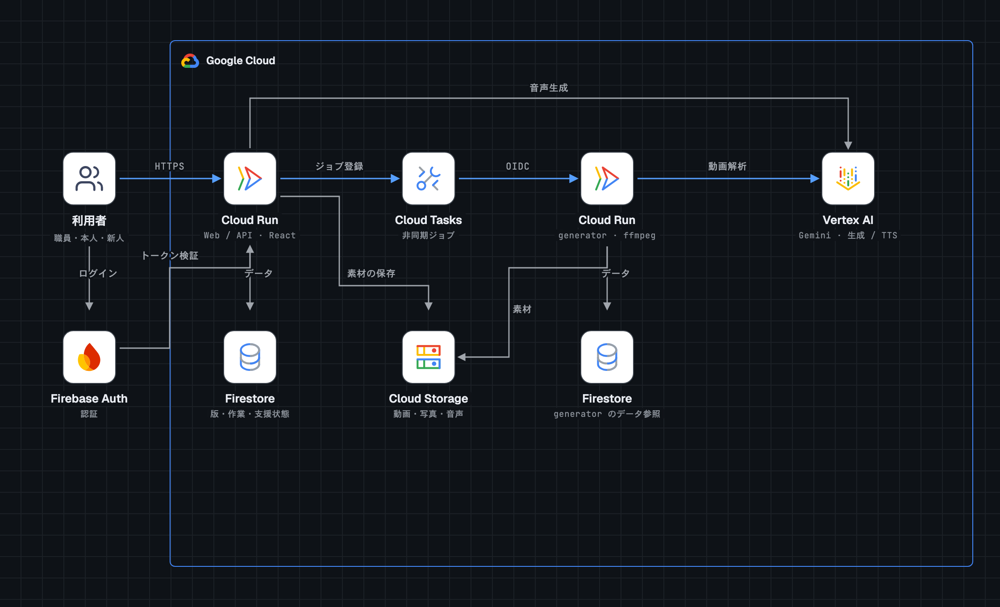

# しごでき

知的障がいのある人が、自分に合う方法で作業手順を確認できるマニュアル作成・共有アプリです。手本動画からAIが下書きを作り、職員が確認・承認した手順を、作業する本人と教え方を引き継ぐ担当者へ届けます。

## 開発に込めた思い

医療や介護のDXが進む一方で、作業所などで働く障がいのある人を支えるDXは、まだ十分ではないのではないか。そんな問題意識が、開発の出発点でした。

メンバーの友人に就労継続支援B型の作業所で勤務する方がおり、その方へのヒアリングを通じて「しごでき」を考えました。目指しているのは、一人ひとりに合う作業手順を用意し、現場で培われた教え方や工夫を、次の担当者にもつなげることです。

本人が自分のペースで手順を確かめ、困ったときには助けを求められる。職員が本人と向き合いながら、伝え方を一緒に考えられる。そうした働く場を、技術で支えたいと考えています。

## Feature

- **手本動画からマニュアルの下書きを作成**：Geminiが動作の順序や声かけを読み取り、工程・短文・写真候補を提案します。写真は原動画から切り出します。
- **職員による確認・編集・承認**：原動画と下書きを照合し、写真や説明を調整して承認します。本人に届けるのは承認済みの手順だけです。
- **本人に合う手順の提示**：本人の希望と職員が確認した方法に合わせ、「写真のみ」「写真と短文」で1工程ずつ表示します。読み上げを使う場合は、承認処理時に短文から音声を事前生成します。
- **作業中の支援と停止**：「手伝って」で職員を呼び、担当や対応の状態を共有します。「やめる」は通信状態にかかわらず端末で即時停止します。作業中は開始時の承認版を使い続けます。
- **教え方の引き継ぎと改善**：新人は承認済みの手順と、確認済みの声かけ・注意点を参照できます。職員の手直しや支援記録は次回の下書きに生かし、改めて確認・承認してから次の作業へ反映します。

## Architecture

Google Cloud上では、画面とAPIを配信するCloud Runと、動画解析を行うCloud Runを分け、Cloud Tasksで非同期処理をつなぎます。

| 技術 | 役割 |
| --- | --- |
| React / TypeScript / Vite | 職員・本人・新人向けの画面 |
| Cloud Run（Web / API） | 画面とAPIの配信、認証・権限の検査、下書きの編集・承認、作業と支援の状態管理 |
| Firebase Authentication | 利用者のログインとIDトークンによる認証 |
| Cloud Tasks | 生成ジョブの登録と、OIDC認証による非公開generatorの呼び出し |
| Cloud Run（generator）/ ffmpeg | 動画解析ジョブの実行と、原動画からの写真の切り出し |
| Vertex AI / Gemini | 動画の動作・声かけをもとにした下書きの生成と、承認済み短文の音声生成（TTS） |
| Firestore / Cloud Storage | 手順・承認版・作業・支援状態の保存と、非公開の動画・写真・音声の保管 |

職員が登録した動画をCloud Storageへ保存し、Cloud Tasksを介してgeneratorがVertex AIによる解析と写真の切り出しを行います。職員は生成された下書きを確認・承認し、本人に割り当てます。読み上げ音声は承認処理時に事前生成し、写真とともに承認版へ固定します。

本人の画面は割り当てられた承認版をAPI経由で取得します。FirestoreとCloud Storageへのアクセスはサーバーで権限を確認し、作業中の支援状態はWebSocketで共有します。
